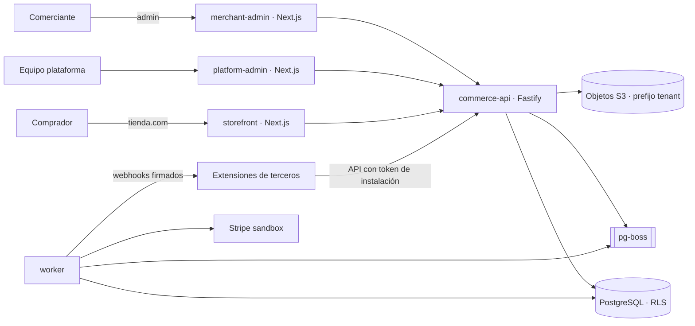
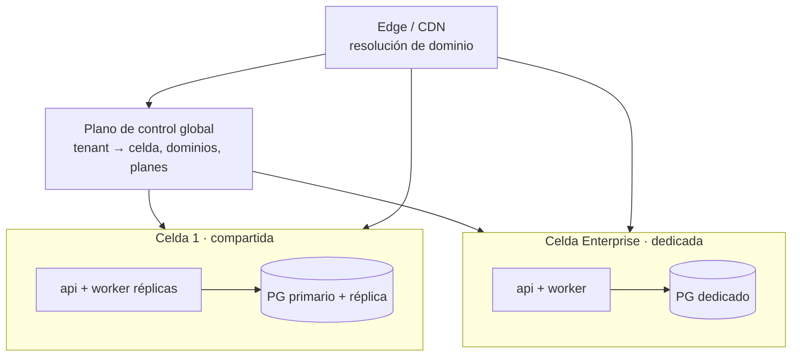

# Arquitectura

Estado: propuesta de Release 0 (pendiente de aprobación). Decisiones en `docs/decisions/`.

## Principio rector

**Monolito modular** con límites de paquete estrictos, desplegado como pocos procesos, organizado en **celdas**. Se separan en servicios solo las piezas con razones reales (seguridad de extensiones de terceros, escalado del storefront).

Comparativa resumida:

| Opción | Pros | Contras | Decisión |
|---|---|---|---|
| Monolito modular | Un despliegue, transacciones locales, refactor barato | Disciplina de límites (se impone con lint de dependencias) | **Base** |
| Microservicios | Escalado y despliegue independientes | Coste operativo, transacciones distribuidas, equipo pequeño | No |
| Híbrido | Storefront y extensiones aparte | — | **Sí, solo en esos dos puntos** |

## Vista de contexto



## Planos lógicos y su ubicación en código

| Plano | Responsabilidad | Paquetes |
|---|---|---|
| A. Control Plane | Usuarios, organizaciones, tiendas, provisionamiento, planes, dominios, roles, cuotas, catálogo de módulos, instalaciones, auditoría global | `packages/tenant`, `packages/auth`, `packages/billing` (R6), esquema `control` |
| B. Commerce Data Plane | Catálogo, variantes, colecciones, inventario, carrito, checkout, pedidos, clientes, promociones, impuestos, devoluciones, fulfillment | `packages/commerce`, esquema `commerce` (RLS) |
| C. Storefront Runtime | Resolver dominio → tienda, cargar tema publicado, render SSR/ISR de bloques autorizados, caché, SEO | `apps/storefront`, `packages/storefront-blocks` |
| D. Extension Platform | Manifiestos, ciclo de vida, permisos, eventos, webhooks, credenciales, auditoría | `packages/plugin-sdk`, `packages/plugin-runtime`, `packages/events`, `modules/*` |
| E. AI Services | Asistente, contenido, configuración guiada, cuotas y coste por tenant | `packages/ai` (R7), siempre vía herramientas con los mismos permisos del usuario |

El plano de control y el de datos comparten clúster en el MVP pero viven en **esquemas distintos** con roles distintos: el rol de la API de comercio no puede leer `control.*` salvo vistas concretas.

## Flujo de una petición del admin

```mermaid
sequenceDiagram
  participant B as Navegador
  participant API as commerce-api
  participant Auth as auth
  participant DB as PostgreSQL
  B->>API: GET /admin/products/:id (cookie de sesión)
  API->>Auth: validar sesión → user_id, tenant_id activo, rol
  Auth-->>API: sesión
  API->>API: RBAC: ¿rol tiene catalog:read?
  API->>DB: BEGIN; set_config('app.tenant_id', tenant, true)
  API->>DB: SELECT … WHERE id = $1   (RLS añade tenant_id = actual)
  DB-->>API: fila o nada
  API->>DB: COMMIT
  API-->>B: 200 o 404 (nunca 403 que confirme existencia)
```

## Celdas



Al principio existe una sola celda. El código es idéntico en todas: el aislamiento físico es una decisión de despliegue, no de código.

## Estructura del monorepo (propuesta, ajustada respecto al directive)

```
apps/
  merchant-admin/     Next.js — panel del comerciante (navegación por capacidades)
  platform-admin/     Next.js — operación interna (R1 mínimo)
  storefront/         Next.js — runtime público multi-dominio (R5)
  commerce-api/       Fastify — API REST + OpenAPI, una sola puerta a la BD
  worker/             pg-boss — eventos, webhooks, sincronizaciones, módulos oficiales
packages/
  config/  db/  auth/  tenant/  commerce/  events/
  plugin-sdk/  plugin-runtime/  payments/  shipping/
  ui/  storefront-blocks/  observability/  ai/ (R7)  billing/ (R6)
modules/
  payments-stripe/  shipping-adapter/  dropshipping-connector/
tests/
  isolation/  contract/  e2e/  performance/   (unit e integración junto a cada paquete)
infra/
  docker/  deployment/  monitoring/
docs/
```

Cambios frente al directive: `packages/db` concentra el acceso SQL (único lugar donde se permite SQL crudo, revisado); los tests unitarios viven junto al código; `tests/isolation` es una suite propia y bloqueante.

## Navegación adaptable

El admin calcula su menú a partir de: capacidades activas de la tienda (derivadas del perfil de onboarding y de los módulos instalados) ∩ permisos del rol del usuario. Los módulos aportan entradas declarativas (`admin:navigation`). Una tienda digital sin la capacidad `physical-inventory` no ve almacenes.
