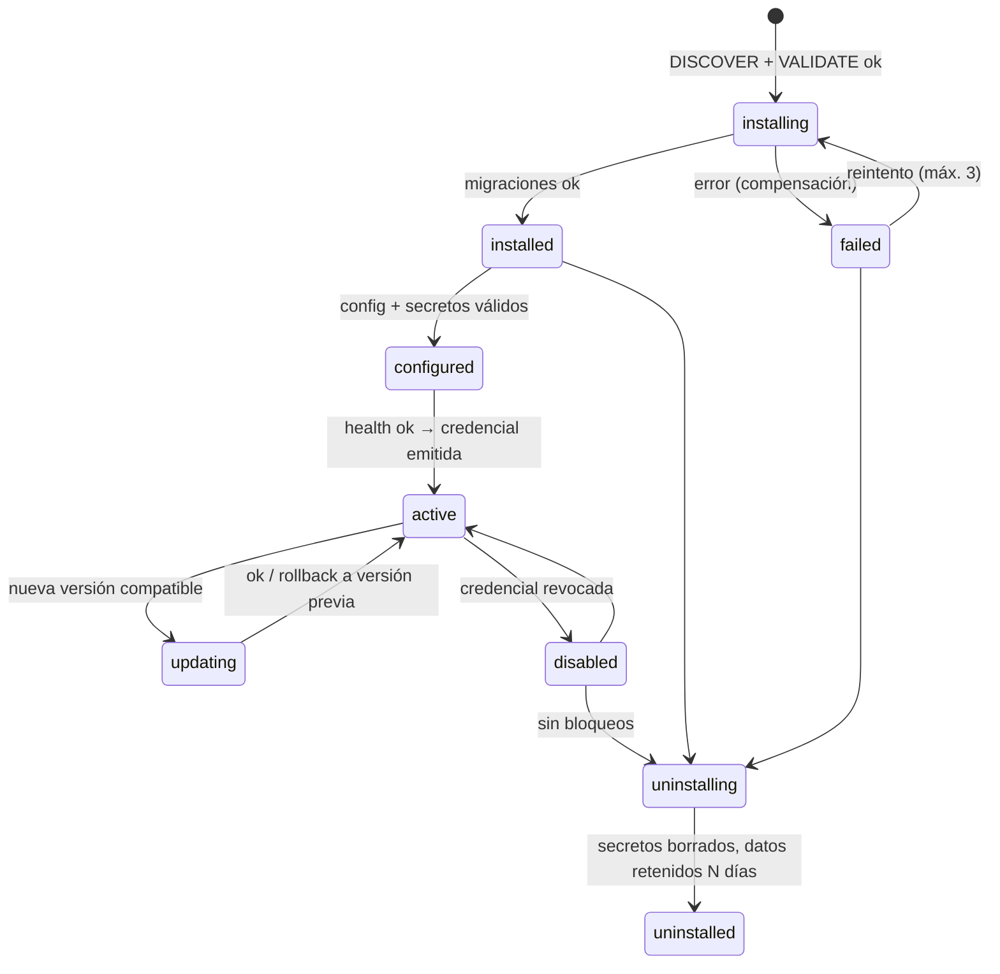

# Especificación de módulos v1 (borrador)

Referencia ejecutable: `poc/module-lifecycle/src/manifest.ts` (Zod) y `src/lifecycle.ts`. Este documento es normativo; si difiere del código de la PoC, manda este documento y la PoC se corrige.

## 1. Manifiesto (`module.json`)

| Campo | Tipo | Reglas |
|---|---|---|
| `manifestVersion` | `1` | Obligatorio |
| `id` | string | Dominio inverso, minúsculas: `com.acme.envios`. Único global |
| `name`, `description` | string | 2–80 / ≤500 caracteres |
| `version` | semver | Versionado semántico estricto |
| `author` | `{name, email?, url?}` | — |
| `license` | string | Identificador SPDX o `Proprietary` |
| *(tier)* | — | **No va en el manifiesto.** Lo asigna el registro de la plataforma tras revisar y firmar el paquete. `customers:pii` solo para `official` en el MVP |
| `compatibility` | `{platform, sdk}` | Rangos semver; la instalación falla si la plataforma no cumple |
| `dependencies` | `{[id]: rango}` | Deben estar instalados y **activos**; ciclos prohibidos |
| `permissions` | lista cerrada | `catalog:read/write`, `inventory:read/write`, `orders:read/write`, `customers:read`, `customers:pii`, `payments:process`, `shipping:rates`, `fulfillment:write`, `storefront:blocks`, `admin:navigation` |
| `capabilities` | lista | `payment-provider` exige `payments:process`; `shipping-carrier` exige `shipping:rates`; `storefront-block` exige `storefront:blocks` |
| `config` | `{[clave]: campo}` | Tipos `string`, `number` (min/max), `boolean`, `enum`. Se renderiza como formulario en el admin |
| `secrets` | `[{name, description, required}]` | Nombres `MAYUSCULAS`. Se guardan cifrados aparte; **nunca** se devuelven ni se registran |
| `events.consumes` | lista cerrada | Eventos de plataforma versionados |
| `events.emits` | `<ns>.accion` | Debe empezar por el último segmento del `id` (no puede suplantar eventos de plataforma) |
| `endpoints` | `{baseUrl, timeoutMs}` | HTTPS a host público: sin IP literal, `localhost`, `.internal`, `.local` ni credenciales en URL; se revalida al resolver DNS y al conectar. Timeout 100–10.000 ms |
| `migrations` | `[{id, description, reversible}]` | Solo para datos propios del módulo en su almacén, nunca en tablas de la plataforma |
| `limits` | `{requestsPerMinute, storageMb}` | Cuotas aplicadas por instalación |
| `updatePolicy` | `auto-patch` \| `auto-minor` \| `manual` | Una versión mayor o permisos nuevos requieren aprobación del comerciante |
| `uninstallPolicy` | `{blockIf[], dataRetentionDays}` | `pending-orders`, `pending-payouts`, `open-shipments` |
| `healthCheck` | `{path, intervalSec}` | Obligatorio para activar |

## 2. Ciclo de vida

Recuperación tras reinicio: `installing`/`uninstalling` → `failed` (reintento controlado); `updating` → `active` en la versión anterior.

## 3. Comunicación

- **Plataforma → módulo:** webhooks `POST {baseUrl}/events` con sobre CloudEvents 1.0, cabeceras `X-Signature: t=<unix>,v1=<HMAC-SHA256(secret, t.body)>`, ventana de 5 min contra repetición, `event_id` para idempotencia.
- **Hooks síncronos** (tarifas de envío, autorización de pago): `POST {baseUrl}/hooks/<nombre>` con timeout del manifiesto y fallback definido por la plataforma.
- **Módulo → plataforma:** API REST con token de instalación (tenant × módulo × scopes). Cada llamada comprueba scope y tenant. Revocado al deshabilitar o desinstalar.
- **Reintentos:** 3 con backoff exponencial con jitter; luego DLQ visible en el admin. Circuit breaker por instalación (abre tras 5 fallos consecutivos, semiabierto a los 60 s).

## 4. Política de compatibilidad

- La API de plataforma y los eventos se versionan (`v1`). Cambios incompatibles → nueva versión mayor con 6 meses de convivencia.
- `compatibility.platform` se comprueba en instalación y actualización.

## 5. Módulos oficiales del MVP (R4)

| Módulo | Integración | Estado esperado al cerrar R4 |
|---|---|---|
| `payments-stripe` | Stripe en modo test: PaymentIntents, webhooks firmados, idempotency keys, reembolsos | Validado en integración con sandbox real |
| `shipping-adapter` | Adaptador con contrato verificable; transportista real en sandbox si se consiguen credenciales, si no **simulador contractual etiquetado como tal** | Probado contra contrato |
| `dropshipping-connector` | Proveedor de API de prueba: importación, sincronización de stock, reglas de precio | Probado contra API de prueba / simulador etiquetado |

Ningún simulador se presentará como integración productiva.

## 6. SDK (`packages/plugin-sdk`)

Tipos y esquema del manifiesto, cliente de API tipado, verificador de firmas de webhook, servidor de desarrollo, **test harness** que reproduce el ciclo de vida y eventos en local, y reglas de seguridad para desarrolladores.
